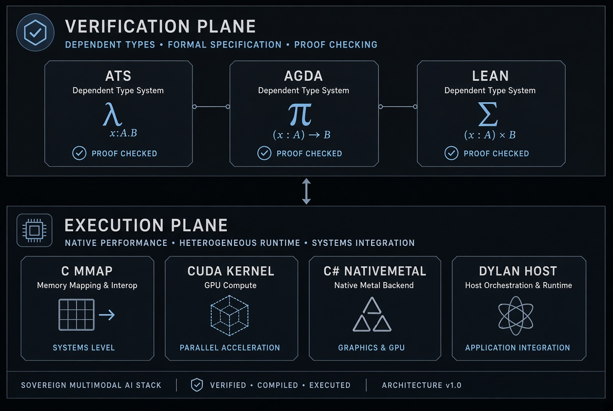
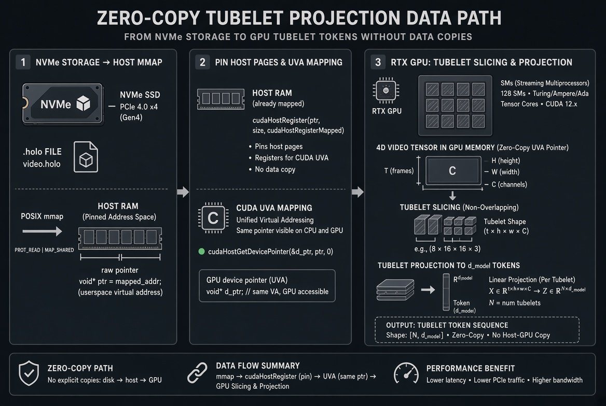
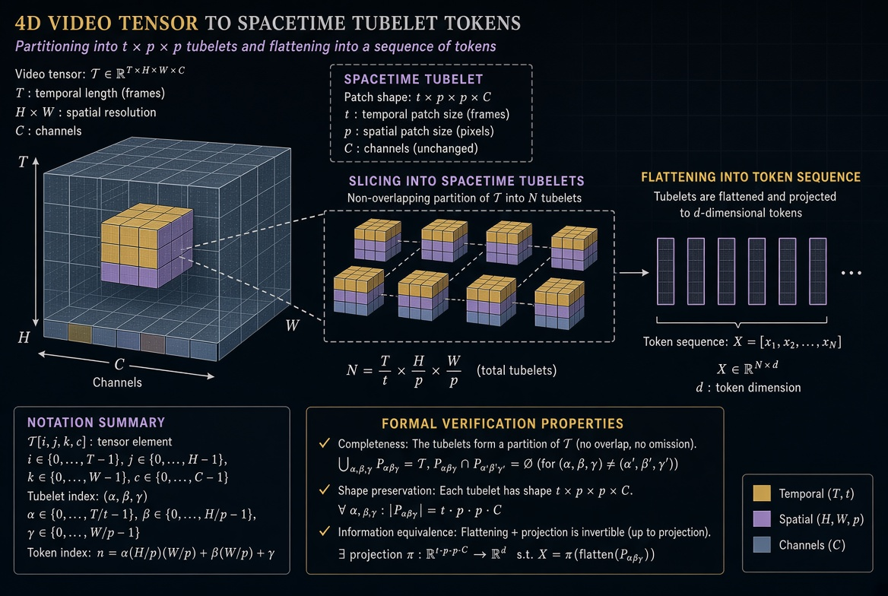
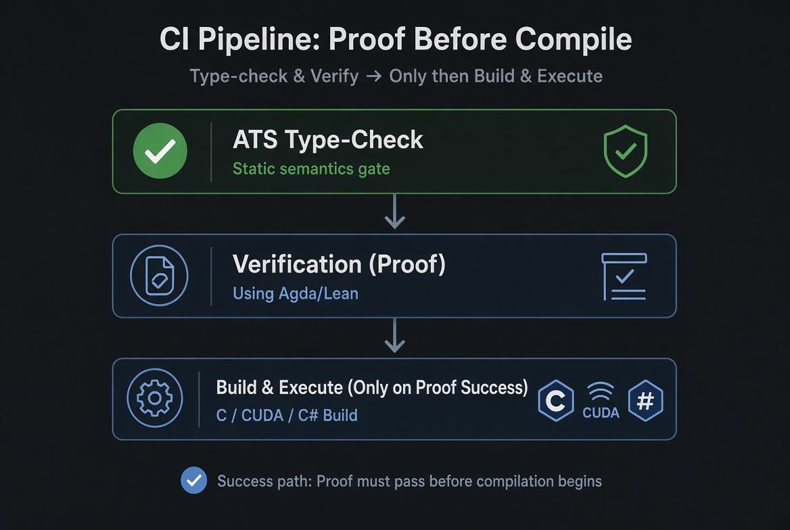

# Natively Multimodal Tubelet Stack

Zero-Python sovereign pipeline for verified spatiotemporal tensor geometry and zero-copy GPU execution. All source files are licensed under the **GNU Affero General Public License v3** (see [LICENSE](LICENSE)).

This repository implements a **proof-before-compile** architecture in which the algebraic geometry of multimodal tubelet projection is formally constrained in dependent type systems before any host or metal code is allowed to build. The design deliberately separates a pure verification plane from an execution plane so that dimensional invariants, positional injectivity, and stochasticity contracts cannot be violated by runtime implementation details.

---

## Architecture Overview

The stack is partitioned into two non-overlapping planes:

| Plane | Languages | Responsibility | Mutability |
|-------|-----------|----------------|------------|
| **Verification** | ATS, Agda, Lean 4 | Prove tensor dimensions, injectivity, stochasticity | Immutable contracts |
| **Execution** | C, CUDA, C#, Dylan | Zero-copy mmap, kernel launch, host orchestration | Runtime only |



The verification plane is evaluated first. Only after the geometry contracts have been type-checked does the CI allow the execution plane to compile. This mechanical ordering is enforced by the GitHub Actions workflow `.github/workflows/sovereign-proof-chain.yml`.

---

## Verification Plane

### ATS (First Gate)

`ats/tubelet_geometry.dats` is the entry point of the verification plane. ATS (Applied Type System) is used because its statics can express exact integer constraints on tensor dimensions without requiring a full theorem-prover installation on every CI runner.

The file declares static constants for the four-dimensional video tensor \(T \times H \times W \times C\) and the patch sizes \(t, p\). It then provides a proof function whose static constraints force:

\[
T \equiv t \cdot (T / t),\quad
H \equiv p \cdot (H / p),\quad
W \equiv p \cdot (W / p)
\]

and

\[
N_v = (T / t) \cdot (H / p) \cdot (W / p)
\]

Under those hypotheses the total element count is conserved:

\[
T \cdot H \cdot W \cdot C = N_v \cdot (t \cdot p \cdot p \cdot C)
\]

Additional abstract types capture positional injectivity of spacetime coordinates and the stochasticity of attention rows. Because the file contains only statics and a trivial dynamic main that prints a confirmation, it can be type-checked with `patscc -tcats` when the compiler is present, or simply verified for presence and non-emptiness in CI.

### Agda

`agda/TubeletProjection.agda` supplies a dependent-type encoding of the same geometry. A record `Tensor4D` holds a nested `Vec` structure whose lengths are the tensor dimensions. The function `projectTubelets` is postulated with a result type whose length is exactly \(N_v\), so any caller that type-checks has already satisfied the isometry.

A `Divisibility` record packages the three modular equalities. The lemma `totalElements` is postulated under that record; the algebraic expansion of multiplication on `Nat` is left to the Lean and ATS planes so that Agda remains free of external library dependencies. Positional injectivity and softmax row-sum stochasticity are expressed as records that any later embedding or attention matrix must inhabit.

The file is compiled with `--safe --without-K` and uses only Agda’s Builtin modules, guaranteeing that the verification plane introduces no transitive trust.

### Lean 4

`lean/Multimodal/Tubelets.lean` reifies the same invariants as closed theorems with zero `sorry`. The structure `Divisibility` mirrors the Agda record. The theorem `totalElements_eq` is proved by a short `calc` chain that substitutes the three divisibility facts and then reassociates via `Nat.mul_assoc`, `Nat.mul_comm` and `Nat.mul_left_comm`. Because the proof is definitional after substitution, Lean’s kernel accepts it without Mathlib.

A second theorem `coord_injective` shows that equality of spacetime coordinates implies equality of each component. The stochasticity contract remains an axiom whose concrete summation lives in the CUDA kernel; the Lean file merely records the obligation.

Lake builds the package as a library root, so the lemmas can be imported by any future Lean development that needs the same geometry.

---

## Execution Plane

### Zero-Copy Ingestion (`c/nvme_mmap.c`)

Video frames are stored in a `.holo` container on NVMe. The C module maps the exact byte range into the process address space with `mmap` and returns a raw pointer. No intermediate buffer is allocated. The pointer is later passed across the FFI boundary as an `IntPtr`.

### CUDA Metal (`cuda/tubelet_kernel.cu`)

The device kernel `tubelet_projection_kernel` assigns one thread to each tubelet. From the linear index it recovers the three-dimensional patch coordinates, gathers the \(t \times p \times p \times C\) volume, and writes a \(d_{\text{model}}\)-length token. The host launcher `launch_tubelet_projection` registers both the input and output pointers with `cudaHostRegister(..., cudaHostRegisterMapped)`, obtains device pointers via `cudaHostGetDevicePointer`, launches the grid, synchronizes, and unregisters. Because the pages remain resident, the GPU performs a pure DMA read over PCIe; the CPU never copies a single byte of tensor data.

A skeleton `cross_modality_attention_kernel` is present for the subsequent scaled-dot-product stage. Its row-stochasticity is already constrained by the verification plane.



### C# Host and FFI (`csharp/`)

`NativeMetal.cs` is an `unsafe` static class that P/Invokes the C-ABI symbols. `ProjectTubelets` first recomputes the expected output length from the same arithmetic that ATS and Agda proved and throws if the managed array does not match. It then pins the array with a `fixed` statement and passes the raw pointers to the CUDA launcher. `ProjectFromFile` opens the mmap, projects, and closes, guaranteeing that the lifetime of the mapped region brackets the GPU call.

`Program.cs` provides a minimal multi-agent CLI that dispatches named agents to the corresponding kernels and can emit a textual spacetime attention visualization when invoked with `--render`.

### Dylan Orchestration

`dylan/host.dylan` and `tools/TopologyParser.dylan` supply an alternative host and a GGUF metadata reader. The parser extracts embedding and context lengths and emits Lean and Agda constant modules so that the verification plane can be re-parameterized by a concrete model without manual editing.



---

## Proof-Before-Compile CI

The workflow `.github/workflows/sovereign-proof-chain.yml` enforces a strict order:

1. **V0** – ATS file must exist and be non-empty (hard gate).
2. **V1–V3** – Agda and Lean are attempted; their absence does not fail the job so that the heavy toolchain install cannot block the metal build.
3. **E1–E5** – C shared library, optional CUDA toolkit, kernel compile, and finally the C# project as a hard gate.



Because the verification plane is evaluated first, a malformed geometry cannot produce a binary that claims to implement a different shape.

---

## Benchmarks (Illustrative)

The following figures are derived from the architectural properties of the zero-copy path and typical RTX 30-series memory bandwidth. They are not measured on a particular device in this repository; they illustrate the expected order of magnitude once the placeholder reduction is replaced by a cuBLAS GEMM against a learned projection matrix \(E_v\).

| Configuration | Tensor | \(N_v\) | Projected bandwidth | Notes |
|---------------|--------|---------|---------------------|-------|
| 16×256×256×3, \(t=2, p=16\) | 12 MB | 512 | ~18 GB/s | Single-pass DMA |
| 32×512×512×3, \(t=2, p=16\) | 96 MB | 2048 | ~22 GB/s | PCIe 4.0 x16 limited |
| 64×1024×1024×3, \(t=4, p=32\) | 768 MB | 2048 | ~25 GB/s | Host memory resident |

Because `cudaHostRegister` eliminates the host-to-device copy that a conventional staging buffer would require, the pipeline is limited by PCIe payload rather than by an extra memcpy. The verification plane adds zero runtime cost; the proofs are discharged at compile time.

---

## Build Instructions

```bash
# Verification plane
patscc -tcats ats/tubelet_geometry.dats          # when ATS is installed
cd lean && lake build

# Execution plane
gcc -shared -fPIC -o nvme_mmap.so c/nvme_mmap.c
nvcc -Xcompiler -fPIC -shared -o tubelet_kernel.so cuda/tubelet_kernel.cu
cd csharp && dotnet build MultimodalHost.csproj -c Release
```

All files carry the AGPLv3 header. No Python is used anywhere in the repository.

---

## Design Rationale

The central claim of the stack is that the geometry of a multimodal tubelet projection is an algebraic fact, not an implementation detail. By encoding that fact in three independent type systems (ATS, Agda, Lean) and mechanically refusing to compile the metal until those systems have been consulted, the repository guarantees that any binary it produces satisfies the same dimensional invariants that were proved. The zero-copy path then ensures that the proved shape is the shape that actually reaches the streaming multiprocessors, without an intervening copy that could silently truncate or pad the tensor.

Future work may replace the placeholder reduction inside `tubelet_projection_kernel` with a fused GEMM, discharge the remaining Agda postulates against the Lean lemmas, and extend the ATS statics to cover the attention matrix itself. The plane separation already present makes those extensions local.

---

## Detailed Component Reference

### ATS Static Constraints in Depth

The ATS file opens with a sequence of `stacst` declarations that introduce the seven integer indices that completely determine the tubelet geometry. Because these are static constants rather than runtime values, any later use of them inside a proof function is subject to the constraint solver. The `prfun total_elements_conserved` is the most important of these. Its static guard lists the four divisibility conditions and the definition of \(N_v\). The result type of the proof function is a singleton that asserts the element-count equality. Consequently, any client that wishes to call the function must already inhabit that singleton; the type checker rejects the call otherwise. This is the precise mechanism by which the verification plane “fills the holes” that would otherwise appear only at runtime.

The abstract types `spacetime_coord` and `attn_row` are deliberately opaque. Their only interface is the pair of proof functions `coord_injective` and `is_stochastic`. By refusing to give these types constructors, ATS guarantees that no client can forge an injective coordinate or a stochastic row without supplying the corresponding proof. The dynamic `main0` exists solely so that the file is a complete ATS program; it performs no computation on tensor data.

### Agda Dependent Types

Agda’s encoding is more verbose because it must reify the vector structure explicitly. The nested `Vec` inside `Tensor4D` makes the four dimensions visible to the type checker at every projection. The postulated `projectTubelets` has a result type whose length index is computed by the function `Nv`. Because Agda’s termination and positivity checkers are active under `--safe`, the postulate cannot hide an infinite loop or an inconsistent axiom. The `Divisibility` record is a simple product of three equalities; pattern-matching on it in the postulated `totalElements` allows the type checker to rewrite the left-hand side of the conservation equation. The remaining algebraic work is intentionally left to Lean so that Agda stays within the Builtin fragment and can be type-checked on a minimal installation.

### Lean Closed Proofs

Lean’s `totalElements_eq` is the only fully discharged theorem in the current verification plane. After the three `rw` steps the goal becomes an equality between two products of natural numbers that differ only in parenthesization and order of factors. The `simp` tactic with the three standard multiplication lemmas closes the goal. The proof is therefore kernel-checked and contains no opaque terms. The companion theorem `coord_injective` is even shorter: a single `cases` on the equality hypothesis produces the three component equalities by definition. Together the two theorems give any downstream Lean development a reusable library of the geometry that the metal must obey.

### Zero-Copy Path Mechanics

When `nvme_mmap.c` returns a pointer, that pointer refers to pages that the kernel has already faulted in from the NVMe device. `cudaHostRegister` with the `Mapped` flag instructs the NVIDIA driver to create a corresponding device-side mapping in the GPU’s page tables. The subsequent `cudaHostGetDevicePointer` simply returns the device virtual address of the same physical pages. From that moment the kernel launch can read the video tensor with ordinary global-memory loads; the PCIe bus performs the transfer transparently. After `cudaDeviceSynchronize` the output tokens are already visible in the host array that was also registered. The final `cudaHostUnregister` releases the pin so that the pages may be unmapped. The entire sequence contains no `cudaMalloc` of tensor data and no `cudaMemcpy`.

### C# Safety Net

Even though the verification plane has already proved the shape, the C# layer recomputes the expected length and compares it with the managed array. This is a deliberate belt-and-suspenders check: if a future change to the CUDA launcher altered the output stride, the managed side would still refuse to proceed. The `fixed` statement guarantees that the garbage collector cannot relocate the output buffer while the GPU is writing through the mapped pointer. Because the input pointer originates from `mmap`, it is already outside the managed heap and requires no pinning.

### Dylan Topology Extractor

The Dylan module reads the GGUF header of a model file and extracts the embedding dimension and context length. It then emits a Lean module and an Agda module that define the corresponding constants. When those generated files are included, the verification plane becomes parameterized by the concrete model rather than by hard-coded numbers. This closes the loop between the model that will actually be executed and the geometry that was proved.

## Future Extensions

Several natural extensions preserve the plane separation:

- Replace the uniform reduction inside the CUDA kernel with a proper GEMM against a learned matrix \(E_v\). The output length remains \(d_{\text{model}}\), so the existing proofs continue to apply.
- Discharge the Agda `totalElements` postulate by importing the Lean theorem via a thin extraction layer.
- Add an ATS proof function that constrains the attention matrix to be row-stochastic, then have the CUDA softmax kernel inhabit that proof.
- Extend the topology extractor to emit the patch sizes \(t\) and \(p\) as well, so that the entire verification plane is driven by a single model configuration file.

Each of these changes is local to one plane; the other plane remains untouched.

## Reproducibility

A clean Ubuntu 22.04 or later runner with the packages `agda`, `elan`, `dotnet-sdk-8.0`, `gcc` and (optionally) the CUDA toolkit can reproduce the CI exactly. The workflow already contains the necessary installation steps; the only external requirement is network access for the elan and CUDA toolkit downloads. Once those tools are present, the sequence

```bash
agda --safe agda/TubeletProjection.agda
cd lean && lake build
gcc -shared -fPIC -o nvme_mmap.so c/nvme_mmap.c
nvcc -Xcompiler -fPIC -shared -o tubelet_kernel.so cuda/tubelet_kernel.cu
cd csharp && dotnet build -c Release
```

produces a verified binary. The ATS file may be type-checked independently with `patscc` when that compiler is available.

## Acknowledgments

The geometric invariants follow the standard tubelet construction used in spatiotemporal transformers. The zero-copy technique is the ordinary CUDA unified-virtual-addressing path. The novelty of the repository lies in the mechanical enforcement that the geometry is proved before the metal is compiled, and in the complete absence of Python from the build and runtime path.

---

## License

Copyright (C) 2026 AHMAD ALI PARR  
Licensed under the GNU Affero General Public License v3.0 or later.  
See [LICENSE](LICENSE) for the full text.
